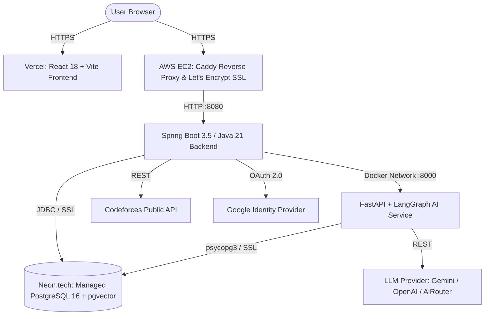

# AlgoMentor 🧠⚡

> **An AI-powered Socratic Interview Preparation & Competitive Programming Copilot**  
> Analyzes real Codeforces submissions, detects struggle patterns, serves rating-calibrated daily problem picks, and mentors your thought process via a spoiler-free Socratic Hint Ladder with deep conversational RAG memory.

🔗 **Live App:** [https://algo-mentor-navy.vercel.app](https://algo-mentor-navy.vercel.app)  
📡 **Live API:** [https://algomentor-api.duckdns.org](https://algomentor-api.duckdns.org)

---

## 🌟 Key Features

### 1. ✨ Dedicated AI Study Tutor (Chatbot & RAG Assistant)
- **Full-Page Conversational UI (`/tutor`):** ChatGPT-style chat interface with starter prompt cards, markdown formatting, code rendering, expandable source citations, and copy action.
- **Multi-Turn Conversational Memory:** Maintains ongoing conversation context across turns, generating history-aware query embeddings.
- **Dual-Source Hybrid Knowledge Base:**
  - **Personal Memory:** Automatically retrieves user's struggle notes and custom takeaways.
  - **Global DSA Knowledge Enrichment:** Asynchronously synthesizes topic foundational guides (invariants, common pitfalls, edge cases) directly into vector storage (`SYSTEM_USER_ID`) with deduplication.

### 2. 🧠 Socratic Problem Mentor (LangGraph + Multi-Provider LLM)
- **3-Level Hint Ladder:**
  - **Level 1 (Guiding Question):** High-level decomposition question without naming algorithms.
  - **Level 2 (Invariant & Pattern):** Discloses algorithmic paradigm or structural invariant.
  - **Level 3 (Strategic Approach):** High-level implementation overview in $\le 5$ sentences.
- **Deterministic Regex Guardrails:** Strictly blocks code snippets, keywords, or syntax leaks before reaching the user.
- **Multi-Provider LLM Engine:** Seamlessly routes between **Google Gemini** (Gemini 2.5 Flash) and **OpenAI-compatible APIs** (e.g. AiRouter, OpenAI, OpenRouter) via lightweight HTTP client.

### 3. 🗄️ Automated & Interactive RAG Memory
- **Auto-Struggle Ingestion:** On Codeforces submission sync, problems with $\ge 2$ failed attempts are automatically analyzed, tagged, and vectorized into PostgreSQL (`pgvector`).
- **Takeaway & Mistake Vault:** 1-click modal on Daily Picks and Mentor Chat to capture specific invariants, edge cases, and learnings.
- **Contextual Recall:** When discussing a topic, Socratic AI recalls past user mistakes and diagnostic struggles with source citations.

### 4. 🎯 100% Unsolved Daily Recommendations
- Automatically calculates the user's effective rating window based on recent solves.
- Prioritizes topics where solve ratio is below 40% (weak tags).
- **Strict Unsolved Guarantee:** Excludes all problems solved via Codeforces submissions and problems previously marked solved in the app.

### 5. 📊 Deep Submissions Analytics & Codeforces Integration
- **Codeforces Profile & Rating Badges:** Live rating & rank badges (Newbie, Pupil, Specialist, Expert, Master, etc.) synced directly from Codeforces API with null-rating handling for unrated accounts.
- **Weak Tags Matrix:** Solve ratio percentages, attempted vs. solved metrics.
- **Daily Solve Trends:** Continuous 7-day, 30-day, and 90-day solve velocity (AreaChart).
- **Rating Accuracy Distribution:** Grouped in 100-rating increments (BarChart).

### 6. 🗺️ Structured DSA Roadmap
- 40+ fundamental interview topics grouped logically into progressive sections.
- Direct problem links with optimistic status updates (`TODO`, `IN_PROGRESS`, `DONE`).

### 7. 📬 Automated Morning Email Digest
- Daily 7:00 AM scheduled cron job.
- Clean, responsive HTML email template delivering curated daily picks.
- Production-ready SMTP support (Gmail / Resend).

---

## 🏗️ Architecture & Production Deployment



### Production Stack:
- **Frontend Hosting:** Vercel (Global Edge Network)
- **Backend & AI Compute:** AWS EC2 (`t3.micro` Ubuntu 24.04 with 2GB Swap + Docker Compose)
- **Database & Vectors:** Neon.tech Cloud PostgreSQL 16 + `pgvector`
- **Reverse Proxy & SSL:** Caddy Server (Auto Let's Encrypt TLS) + DuckDNS (`algomentor-api.duckdns.org`)

---

## 🛠️ Tech Stack Matrix

| Layer | Technologies |
|---|---|
| **Frontend** | React 18, Vite, React Router 6, Tailwind CSS, Recharts, Lucide Icons, KaTeX |
| **Backend** | Spring Boot 3.5, Java 21, Spring Security (OAuth2 + JWT), Spring Data JPA, Hibernate, Thymeleaf |
| **AI Service** | FastAPI, LangGraph, fastembed (`bge-small-en-v1.5`), psycopg 3, httpx |
| **Database** | PostgreSQL 16 + `pgvector` extension for vector similarity search |
| **LLM Inference** | OpenAI-compatible APIs (AiRouter, GPT-5.2) & Google Gemini 2.5 Flash |
| **Infra & DevOps** | Docker, Docker Compose, AWS EC2, Caddy, Vercel, Neon.tech |

---

## ⚙️ Local Development Setup

### 1. Prerequisites
- **Java 21**
- **Node.js 20+**
- **Python 3.12+**
- **Docker & Docker Compose** (for local Postgres + pgvector)

### 2. Environment Setup
Copy `.env.example` to `.env`:

```env
# Database (Local Docker or Cloud Neon)
DB_HOST=localhost
DB_PORT=5432
DB_NAME=algomentor
DB_USER=postgres
DB_PASSWORD=postgres
DB_SSLMODE=prefer

# Google OAuth2
GOOGLE_CLIENT_ID=your_google_client_id
GOOGLE_CLIENT_SECRET=your_google_client_secret
OAUTH2_REDIRECT_URI=http://localhost:5173/auth/callback

# Security & JWT
JWT_SECRET=your_32_character_minimum_hmac_secret
JWT_EXPIRY_MINUTES=60

# LLM Configuration (OpenAI or Gemini)
LLM_PROVIDER=openai
LLM_MODEL=openai/gpt-5.2
OPENAI_API_KEY=your_openai_or_airouter_key
OPENAI_BASE_URL=https://api.airouter.in/v1

# AI Service URL
AI_SERVICE_URL=http://localhost:8000
```

### 3. Run Services Locally

#### Database (Local Docker):
```bash
docker compose up -d postgres
```

#### AI Service (FastAPI):
```bash
cd ai-service
python3 -m venv .venv && source .venv/bin/activate
pip install -r requirements.txt
uvicorn app.main:app --host 0.0.0.0 --port 8000 --reload
```

#### Backend (Spring Boot):
```bash
cd backend
./mvnw spring-boot:run
```

#### Frontend (React + Vite):
```bash
cd frontend
npm install
npm run dev
```

Visit **`http://localhost:5173`** to access the application locally.

---

## 🔒 Safety & Deterministic Guardrails
AlgoMentor enforces strict output guardrails using both prompt engineering and deterministic regex checks. If any level output contains:
- Code fences (` ``` `), inline keywords (`def`, `function`, `class`, `import`), or variable assignments (`x = ...`)
- The output fails verification and automatically falls back to an invariant-safe guiding response, preventing answer spoilers.
