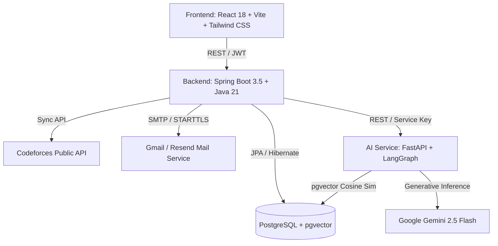

# AlgoMentor 🧠⚡

> **An AI-powered Socratic Interview Preparation & Competitive Programming Copilot**  
> Analyzes real Codeforces submissions, detects struggle patterns, serves rating-calibrated daily problem picks, and mentors your thought process via a spoiler-free Socratic Hint Ladder with deep RAG memory.

---

## 🌟 Key Features

### 1. 🧠 Socratic AI Mentor (LangGraph + Gemini 2.5)
- **3-Level Hint Ladder:**
  - **Level 1 (Guiding Question):** High-level decomposition question without naming algorithms.
  - **Level 2 (Invariant & Pattern):** Discloses algorithmic paradigm or structural invariant.
  - **Level 3 (Strategic Approach):** High-level implementation overview in $\le 5$ sentences.
- **Deterministic Regex Guardrail:** Strictly blocks code snippets, keywords, or syntax leaks before reaching the user.
- **Stateful Progression:** Tracks progress per problem with reset capability.

### 2. 🗄️ Automated & Interactive RAG Memory
- **Auto-Struggle Ingestion:** On Codeforces submission sync, problems with $\ge 2$ failed attempts are automatically analyzed and vectorized into PostgreSQL (`pgvector`) without manual user effort.
- **Takeaway & Mistake Vault:** 1-click modal on Daily Picks and Mentor Chat to capture specific invariants, edge cases, and learnings.
- **Contextual Recall:** When discussing a topic, Socratic AI recalls past user mistakes and diagnostic struggles with source citations.

### 3. 🎯 100% Unsolved Daily Recommendations
- Automatically calculates the user's effective rating window based on recent solves.
- Prioritizes topics where solve ratio is below 40% (weak tags).
- **Strict Unsolved Guarantee:** Excludes all problems solved via Codeforces submissions and problems previously marked solved in the app.

### 4. 🗺️ Structured DSA Roadmap
- 40+ fundamental interview topics grouped logically into progressive sections.
- Direct problem links with optimistic status updates (`TODO`, `IN_PROGRESS`, `DONE`).

### 5. 📊 Deep Submissions Analytics
- **Weak Tags Matrix:** Solve ratio percentages, attempted vs. solved metrics.
- **Daily Solve Trends:** Continuous 7-day, 30-day, and 90-day solve velocity (AreaChart).
- **Rating Accuracy Distribution:** Grouped in 100-rating increments (BarChart).

### 6. 📬 Automated Morning Email Digest
- Daily 7:00 AM scheduled cron job.
- Clean, responsive HTML email template delivering curated daily picks.
- Production-ready SMTP support (Gmail / Resend).

### 7. 🚀 Modern SaaS Landing Page
- Public interactive landing page at `/` with feature breakdown and 3-step routine.
- Protected route gating for authenticated dashboard, chat, and roadmap access.

---

## 🏗️ Architecture & Tech Stack



| Layer | Technologies |
|---|---|
| **Frontend** | React 18, Vite, React Router 6, Tailwind CSS, Recharts, Lucide Icons |
| **Backend** | Spring Boot 3.5, Java 21, Spring Security (OAuth2 + JWT), Spring Data JPA, Thymeleaf |
| **AI Service** | FastAPI, LangGraph (StateGraph), psycopg 3, Pydantic, Gemini 2.5 Flash |
| **Database** | PostgreSQL 16 with `pgvector` extension for semantic vector similarity |
| **External APIs** | Codeforces API, Google OAuth2, Resend/Gmail SMTP |

---

## ⚙️ Getting Started

### 1. Prerequisites
- **Java 21**
- **Node.js 20+**
- **Python 3.12+**
- **PostgreSQL 16** with `pgvector` extension

### 2. Environment Setup
Create a root `.env` file (copied from `.env.example`):

```env
# Database
DB_HOST=localhost
DB_PORT=5432
DB_NAME=algomentor
DB_USER=postgres
DB_PASSWORD=postgres

# Google OAuth2
GOOGLE_CLIENT_ID=your_google_client_id
GOOGLE_CLIENT_SECRET=your_google_client_secret
OAUTH2_REDIRECT_URI=http://localhost:5173/auth/callback

# Security & JWT
JWT_SECRET=your_32_character_minimum_hmac_secret
JWT_EXPIRY_MINUTES=60
AI_SERVICE_KEY=your_service_to_service_auth_key

# Mail Service
MAIL_HOST=smtp.gmail.com
MAIL_PORT=587
MAIL_USERNAME=your_email@gmail.com
MAIL_PASSWORD=your_16_char_app_password
MAIL_FROM=your_email@gmail.com
MAIL_SMTP_AUTH=true
MAIL_SMTP_STARTTLS_ENABLE=true
MAIL_SMTP_STARTTLS_REQUIRED=true

# AI Service
LLM_PROVIDER=gemini
LLM_MODEL=gemini-2.5-flash
GEMINI_API_KEY=your_gemini_api_key
```

### 3. Running Services

#### AI Service (FastAPI):
```bash
cd ai-service
python3 -m venv .venv && source .venv/bin/activate
pip install -r requirements.txt
uvicorn app.main:app --host 0.0.0.0 --port 8000 --reload
```

#### Backend (Spring Boot):
```bash
cd backend
./mvnw spring-boot:run
```

#### Frontend (React + Vite):
```bash
cd frontend
npm install
npm run dev
```

Visit **`http://localhost:5173`** to access the application.

---

## 🔒 Safety & Deterministic Guardrails
AlgoMentor enforces strict output guardrails using both prompt engineering and deterministic regex checks. If any level output contains:
- Code fences (` ``` `), inline keywords (`def`, `function`, `class`, `import`), or variable assignments (`x = ...`)
- The output fails verification and automatically falls back to an invariant-safe guiding response, preventing answer spoilers.
---